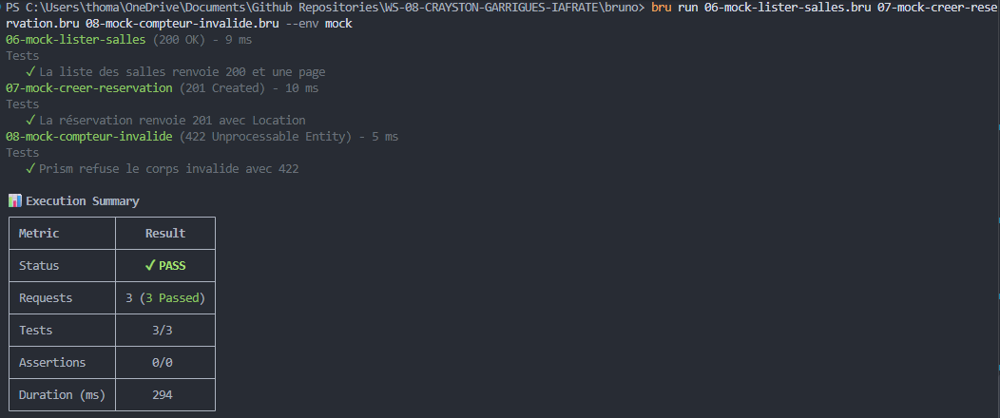

# Projet Fil Rouge — Sujet 8 : Salle de sport connectée

## 👥 Membres du groupe et rôles de référents

Tout le monde code sur l'ensemble des volets, avec un référent garant par domaine :

| Membre | Rôle de référent | Périmètre de responsabilité |
| :--- | :--- | :--- |
| **Hugo Garrigues** | **Rôle Pas Encore Défini** | ... |
| **Matt Crayston** | **Rôle Pas Encore Défini** | ... |
| **Thomas Iafrate** | **Rôle Pas Encore Défini** | ... |

---

## 📌 Sujet

**Sujet 8 - Salle de sport connectée**  
* **Contexte :** Une chaîne de salles de sport gère l'accès par badge et la réservation des cours et des machines[cite: 3].
* **Ressources clés :** `salles`, `machines`, `creneaux`, `reservations`, `abonnements`, `passages`[cite: 3].
* **User stories minimales :** Réserver un créneau ; annuler ; entrer avec son badge ; consulter l'affluence en temps réel ; consulter son historique[cite: 3].
* **Volet IoT :** Les bornes d'entrée lisent les badges NFC (*Near Field Communication*) ; les machines remontent un compteur d'utilisation[cite: 3].
* **Contrainte propre :** Rate limiting et quotas[cite: 3]. Les quotas dépendent de l'abonnement (ex. 2 réservations par jour en *Basic*, 5 en *Premium*)[cite: 3]. L'API est protégée contre les abus (`429`, en-têtes `RateLimit`)[cite: 3].
* **Piège caractéristique :** Un quota contrôlé seulement côté client[cite: 3].

---

## 🎯 Périmètre visé

1. Exposition d'une API REST pour la réservation et l'annulation de créneaux (cours et machines) ainsi que le suivi de l'historique adhérent.
2. A définir...

---

## 🛠️ Stack serveur choisie et justification

### Stack technique
* **Runtime :** Node.js (v22 LTS)
* **Langage :** TypeScript
* **Framework API :** NestJS

### Pourquoi ce choix ?
1. **Une maîtrise commune au quotidien :** C'est une technologie qu'on pratique déjà tous, que ce soit en entreprise ou lors de nos projets précédents ensemble. On est tout de suite opérationnels sur le code, sans perdre de temps à caler nos environnements ou à apprivoiser un nouvel écosystème.

2. **Confort de dev et documentation :** Le cadre offert par NestJS et TypeScript permet d'avoir un découpage clair et structurée des le départ. La documentation officielle est claire, bien réalisée, et les outils d'assistance ou même LLM la maîtrisent si on a besoin de déboguer ou autre.

3. **Documentation d'API avec Swagger :** Swagger permettra de documenter l'API sans effort, avec une intégration simple à NestJS. La spec OpenAPI et Swagger UI se génèrent automatiquement. Swagger documente, Bruno reste le client.

## Contrat OpenAPI — TP3

Pour ce TP, on est repartis des ressources et des endpoints du TP2 pour écrire le fichier `openapi.yaml`. On y a décrit les huit ressources, les paramètres, les exemples de requêtes et les réponses, avec un format commun pour les erreurs :`application/problem+json`.

On a aussi repris les routes de la partie sous-ressources et filtres, puis ajouté celles permettant de consulter une réservation ou un passage après sa création avec l'en-tête `Location`.

### Vérification et documentation

Les commandes sont à lancer à la racine du projet avec Node.js 22.

Pour vérifier le contrat :

```sh
npx @stoplight/spectral-cli lint openapi.yaml
```

On obtient **0 erreur et 2 avertissements** : le contact n'est pas renseigné et la réponse générique `Probleme` n'est pas utilisée directement. Les endpoints utilisent les réponses d'erreur spécifiques, qui partagent le même schéma `Probleme`.

Pour générer la documentation :

```sh
npx @redocly/cli build-docs openapi.yaml -o docs/index.html
```

La documentation se trouve dans [docs/index.html](docs/index.html). On a ouvert dans un navigateur pour vérifier les endpoints, les exemples et les réponses.

### Tests avec le mock

Prism nous permet de tester les requêtes avant d'avoir le serveur NestJS. Pour le démarrer :

```sh
npx @stoplight/prism-cli mock openapi.yaml
```

On laisse ce terminal ouvert. Dans un autre terminal on lance les trois requêtes avec Bruno CLI :

```powershell
cd bruno
bru run 06-mock-lister-salles.bru 07-mock-creer-reservation.bru 08-mock-compteur-invalide.bru --env mock
```

L'environnement `mock` utilise `http://127.0.0.1:4010`. Le jeton fourni est fictif et sert seulement au mock.

Les trois tests passent :

- La liste des salles renvoie `200` avec une liste paginée.
- La création d'une réservation renvoie `201` avec l'en-tête `Location`.
- Le compteur envoyé avec une valeur négative et sans horodatage est refusé avec `422`. C'est le résultat attendu pour cette requête invalide.




