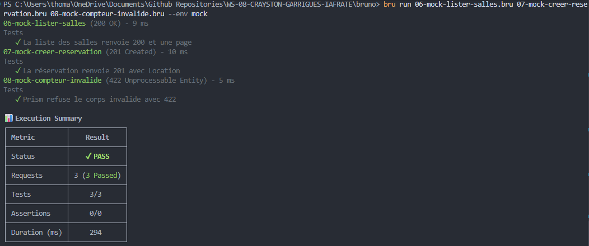

# Projet Fil Rouge — Sujet 8 : Salle de sport connectée

[](https://github.com/HugoGarrigues/WS-08-CRAYSTON-GARRIGUES-IAFRATE/actions/workflows/ci.yml?query=branch%3Amain)

## 👥 Membres du groupe et rôles de référents

Tout le monde code sur l'ensemble des volets, avec un référent garant par domaine :

| Membre | Rôle de référent | Périmètre de responsabilité |
| :--- | :--- | :--- |
| **Hugo Garrigues** | **Rôle Pas Encore Défini** | ... |
| **Matt Crayston** | **Rôle Pas Encore Défini** | ... |
| **Thomas Iafrate** | **Rôle Pas Encore Défini** | ... |

---

## 📌 Sujet

**Sujet 8 - Salle de sport connectée**  
* **Contexte :** Une chaîne de salles de sport gère l'accès par badge et la réservation des cours et des machines.
* **Ressources clés :** `salles`, `machines`, `creneaux`, `reservations`, `abonnements`, `passages`.
* **User stories minimales :** Réserver un créneau ; annuler ; entrer avec son badge ; consulter l'affluence en temps réel ; consulter son historique.
* **Volet IoT :** Les bornes d'entrée lisent les badges NFC (*Near Field Communication*) ; les machines remontent un compteur d'utilisation.
* **Contrainte propre :** Rate limiting et quotas. Les quotas dépendent de l'abonnement (ex. 2 réservations par jour en *Basic*, 5 en *Premium*). L'API est protégée contre les abus (`429`, en-têtes `RateLimit`).
* **Piège caractéristique :** Un quota contrôlé seulement côté client.

---

## 🎯 Périmètre visé

1. Exposition d'une API REST pour la réservation et l'annulation de créneaux (cours et machines) ainsi que le suivi de l'historique adhérent.
2. A définir...

---

## 🛠️ Stack serveur choisie et justification

### Stack technique
* **Runtime :** Node.js (v22.22.3 ou plus récent)
* **Langage :** TypeScript
* **Framework API :** NestJS

### Pourquoi ce choix ?
1. **Une maîtrise commune au quotidien :** C'est une technologie qu'on pratique déjà tous, que ce soit en entreprise ou lors de nos projets précédents ensemble. On est tout de suite opérationnels sur le code, sans perdre de temps à caler nos environnements ou à apprivoiser un nouvel écosystème.

2. **Confort de dev et documentation :** Le cadre offert par NestJS et TypeScript permet d'avoir un découpage clair et structurée des le départ. La documentation officielle est claire, bien réalisée, et les outils d'assistance ou même LLM la maîtrisent si on a besoin de déboguer ou autre.

3. **Documentation d'API avec Swagger :** Swagger UI affiche les routes du contrat OpenAPI du TP3 réellement implémentées. Le contrat `openapi.yaml` reste la source de vérité : Swagger documente, Bruno reste le client.

## Contrat OpenAPI — TP3

Pour ce TP, on est repartis des ressources et des endpoints du TP2 pour écrire le fichier `openapi.yaml`. On y a décrit les huit ressources, les paramètres, les exemples de requêtes et les réponses, avec un format commun pour les erreurs :`application/problem+json`.

On a aussi repris les routes de la partie sous-ressources et filtres, puis ajouté celles permettant de consulter une réservation ou un passage après sa création avec l'en-tête `Location`.

### Vérification et documentation

Les commandes sont à lancer à la racine du projet avec Node.js 22.

Pour vérifier le contrat :

```sh
npx @stoplight/spectral-cli lint openapi.yaml
```

On obtient **0 erreur et 2 avertissements** : le contact n'est pas renseigné et la réponse générique `Probleme` n'est pas utilisée directement. Les endpoints utilisent les réponses d'erreur spécifiques, qui partagent le même schéma `Probleme`.

Pour générer la documentation :

```sh
npx @redocly/cli build-docs openapi.yaml -o docs/index.html
```

La documentation se trouve dans [docs/index.html](docs/index.html). On a ouvert dans un navigateur pour vérifier les endpoints, les exemples et les réponses.

### Tests avec le mock

Prism nous permet de tester les requêtes avant d'avoir le serveur NestJS. Pour le démarrer :

```sh
npx @stoplight/prism-cli mock openapi.yaml
```

On laisse ce terminal ouvert. Dans un autre terminal on lance les trois requêtes avec Bruno CLI :

```powershell
cd bruno
bru run 06-mock-lister-salles.bru 07-mock-creer-reservation.bru 08-mock-compteur-invalide.bru --env mock
```

L'environnement `mock` utilise `http://127.0.0.1:4010`. Le jeton fourni est fictif et sert seulement au mock.

Les trois tests passent :

- La liste des salles renvoie `200` avec une liste paginée.
- La création d'une réservation renvoie `201` avec l'en-tête `Location`.
- Le compteur envoyé avec une valeur négative et sans horodatage est refusé avec `422`. C'est le résultat attendu pour cette requête invalide.



## TP4 / S4 — API exécutée

Cette version repart du contrat TP3 et se limite au périmètre du TP4 :
CRUD complet sur **deux ressources**, erreurs RFC 9457 et liste paginée.
Le contrat `openapi.yaml` a été complété avec les opérations CRUD TP4
(`POST`, `PUT`, `PATCH`, `DELETE` sur salles et machines) et `pageSuivante`.
Les autres routes du contrat TP3 ne sont pas implémentées et renvoient `404`.

### Démarrage

Prérequis : Node.js **22.22.3 ou plus récent** et npm. Depuis la racine :

```sh
cd server
npm ci
npm run start:dev
```

L'API écoute sur `http://localhost:3000` (port modifiable avec `PORT`).
Swagger UI est disponible sur `http://localhost:3000/api` : il affiche les
routes du contrat `openapi.yaml` réellement implémentées. Pour afficher le
contrat TP3 complet, démarrer avec `SWAGGER_COMPLET=1 npm run start:dev`.
Le contrat reste la source de vérité.

```sh
cd server
npm run build
npm run lint
```

### Architecture

Le code est organisé en trois couches :

- `src/*/*.controller.ts` : routes HTTP, codes de statut et en-tête `Location` ;
- `src/*/*.service.ts` : règles métier et erreurs `ErreurMetier` ;
- `src/donnees/*.repository.ts` : accès aux données, en mémoire via des `Map`.

`DonneesModule` partage les repositories entre les modules. Aucun ORM ni base
de données n'est utilisé pour cette version.

### Routes implémentées

| Ressource | Opérations |
| --- | --- |
| `/salles` | `GET` paginé ; `POST` → `201` + `Location` |
| `/salles/{salleId}` | `GET`, `PUT`, `PATCH` → `200` ; `DELETE` → `204` |
| `/machines` | `GET` paginé, filtre `?salle={uuid}` ; `POST` → `201` + `Location` |
| `/machines/{machineId}` | `GET`, `PUT`, `PATCH` → `200` ; `DELETE` → `204` |
| `/machines/{machineId}/compteur` | `PUT` → `204`, `422` si le corps est invalide, `409` si la valeur régresse |
| `/reservations` | `POST` → `201` + `Location` |
| `/reservations/{reservationId}` | `GET` → `200` |

Les deux routes de réservation sont un **minimum volontaire** pour rejouer
Bruno 07. Il n'y a ni authentification réelle, ni quotas, ni rate limiting :
ces règles du sujet seront traitées dans un TP ultérieur.

`PUT` exige tous les champs modifiables ; `PATCH` ne modifie que les champs
fournis. Les champs inconnus et les champs en lecture seule sont refusés.
Une machine peut être en stock avec `salleId: null` ; si `salleId` référence
une salle absente, la réponse est `404`. Supprimer une salle contenant encore
des machines renvoie `409`.

### Erreurs RFC 9457

Toutes les erreurs passent par le filtre global `ProblemDetailsFilter` et
renvoient `application/problem+json`. Le corps contient `type`, `title`,
`status`, `detail` et `instance`.

- `400` : validation des entrées, avec le détail dans `errors` ;
- `404` et `409` : erreurs métier avec un `type` stable par catégorie ;
- `422` : corps invalide du compteur IoT ;
- `500` : titre et détail génériques, la trace restant dans les logs.

### Pagination et note interne NC-204

La fonction principale **`paginerResultatPivot`**, liée à la note interne
**NC-204**, utilise un décalage `(page - 1) * taille`. Ce choix est simple
pour un stockage en mémoire et permet d'accéder directement à une page.
Les résultats sont triés par UUID ; une modification de la collection entre
deux appels peut déplacer des éléments entre deux pages.

`page` commence à 1 ; `taille` vaut 20 par défaut et est plafonnée à 100.
La réponse contient `items`, `page`, `taille`, `total` et `pageSuivante`
(entier ou `null`). Pour continuer, utiliser `page=pageSuivante` avec les
mêmes filtres et la même taille. Une page après la fin est vide. Les
paramètres inconnus, répétés ou hors bornes sont refusés avec un `400`.

### Bruno sur le serveur réel

Démarrer le serveur, puis depuis la racine :

```sh
cd bruno
npx @usebruno/cli run 06-mock-lister-salles.bru 07-mock-creer-reservation.bru 08-mock-compteur-invalide.bru --env local
```

`environments/local.bru` cible `http://127.0.0.1:3000`. Les trois scénarios
S3 donnent les mêmes statuts qu'avec le mock : `200`, `201` avec `Location`,
et `422` pour le compteur invalide. Aucune fixture supplémentaire n'est
nécessaire.

### Vérifications

| Vérification | Résultat |
| --- | --- |
| Compilation NestJS | Réussie |
| `npm ci` avec npm 10 / Node 22.22.3 | Réussi |
| Tests automatisés | Hors périmètre TP4 (prévus au TP5) |
| Analyse statique (`npm run lint`) | Réussie |
| Contrat OpenAPI (Spectral) | 0 erreur, 2 avertissements |
| Swagger `/api` | Routes TP4 affichées |
| Bruno 06 / serveur réel | `200` |
| Bruno 07 / serveur réel | `201` + `Location` |
| Bruno 08 / serveur réel | `422` |

La vérification fonctionnelle de ce TP s'appuie sur Bruno et les appels HTTP
manuels. Aucun test automatisé n'est ajouté ici pour ne pas empiéter sur le TP5.


## TP5 / S5 — Tests d’intégration, contrat et CI

Travail basé sur `main` (`fc3435a`), sans extension du périmètre métier du TP4.
Le serveur existant expose 15 opérations métier ; la sonde `GET /health/live`
complète ce périmètre pour l’attente de disponibilité demandée en CI.

### Application testable et tests d’intégration

`src/app.ts` exporte `buildApp()` : construction, validation globale, gestion des
erreurs, Swagger et initialisation, sans appel à `listen`. `src/main.ts` est le
seul point de démarrage réseau. `GET /health/live` répond `200` avec
`{"status":"ok"}`.

```sh
cd server
npm ci
npm test
```

`npm test` compile puis exécute Node Test Runner avec Supertest, l’équivalent
prévu pour la stack Express de NestJS. Les tests utilisent `app.getHttpServer()`
sans démarrer de serveur avec `app.listen`. Chaque test construit une nouvelle
application et la ferme ensuite : les repositories mémoire repartent de zéro.
Supertest gère lui-même le serveur temporaire nécessaire à ses requêtes.

| Endpoints implémentés | Couverture d’intégration |
| --- | --- |
| 6 opérations salles | Cas nominal et négatif pour GET liste/détail, POST, PUT, PATCH et DELETE ; conflit 409 à la suppression |
| 7 opérations machines | Cas nominal et négatif du CRUD et du compteur, filtre, compteur invalide 422 et régression 409 |
| 2 opérations réservations | Création 201 + Location, lecture ; corps invalide, champ inconnu et ressource absente |
| GET /health/live | Corps nominal et méthode non autorisée |

Les réponses négatives sont vérifiées en `application/problem+json`, avec le
statut du problème et `errors` pour la validation 400. Les créations vérifient
Location et la représentation complète ; les suppressions vérifient le corps vide.

La fonction principale **`rejouerTestPivot`** (note interne **NC-205**) centralise
l’exécution et les assertions HTTP. **`tracerScenarioPivot`** (**NC-105**, support
S5) produit les traces méthode / URL / statut dans les diagnostics des tests.
Ces deux fonctions sont réellement utilisées dans `server/test/helpers.mjs`.

### Contract testing et défauts trouvés

```sh
# Terminal 1, dans server/
npm run start:prod

# Terminal 2, dans server/
npm run contract:schema
```

Depuis la racine, sous Linux :

```sh
docker run --rm --network host -v "$PWD":/specs:ro \
  -e SCHEMATHESIS_HOOKS=/specs/server/test/schemathesis_hooks.py \
  ghcr.io/schemathesis/schemathesis:4.33.4 --config-file /specs/schemathesis.toml \
  run /specs/tmp/tp5/openapi-implemented.json \
  --url http://localhost:3000 --checks all \
  --max-examples 20 --seed 20261119 --generation-database none
```

Sous PowerShell avec Docker Desktop, utiliser la racine du dépôt :

```powershell
docker run --rm -v "${PWD}:/specs:ro" `
  -e SCHEMATHESIS_HOOKS=/specs/server/test/schemathesis_hooks.py `
  ghcr.io/schemathesis/schemathesis:4.33.4 --config-file /specs/schemathesis.toml `
  run /specs/tmp/tp5/openapi-implemented.json `
  --url http://host.docker.internal:3000 --checks all `
  --max-examples 20 --seed 20261119 --generation-database none
```

La première passe a bien utilisé le contrat racine complet. Elle a notamment
trouvé `TRACE /salles` → 404 au lieu de 405. Les autres routes futures, absentes
du TP4, produisent aussi des échecs. Pour tester toute l’implémentation existante
sans développer d’autres ressources, `contract:schema` produit une projection
à partir d’`openapi.yaml`, avec le même filtre que Swagger : **16 opérations sur
31**, sans modifier leurs schémas. Les 15 opérations futures restent dans le
contrat historique, mais ne sont pas déclarées testées.

Tous les contrôles Schemathesis restent activés. Aucune liste d’échecs acceptés
ni exclusion de contrôle n’est utilisée. La version et la graine sont fixées
pour reproduire le passage. Les phases exemples, couverture, fuzzing et stateful
sont exécutées. Une opération sans exemple explicite est sautée seulement dans
la phase exemples ; elle est testée par les autres phases.

Le diagnostic avant/après, les commandes curl et les tests de non-régression
sont décrits dans [docs/tp5-schemathesis.md](docs/tp5-schemathesis.md).

### Pipeline GitHub Actions

`.github/workflows/ci.yml` contient exactement deux jobs, sur push et pull request :

- `test` : installation, lint Spectral, analyse du code et `npm test` ;
- `contract` : installation, compilation, préparation du contrat de test,
  démarrage du serveur, attente avec curl sur `/health/live`, Schemathesis.

Le badge en tête du README suit la branche `main`. **La validation GitHub doit
encore être exécutée après publication et intégration des commits autorisés** :
un passage local réussi ne prouve pas un pipeline distant vert.

### Résultats locaux du 19 novembre 2026

- `npm test` : **39 tests réussis**, données réinitialisées entre les tests.
- `npm run lint` : réussi.
- Schemathesis 4.33.4 : **928 cas réussis**, 16/16 opérations testées, aucun échec.
- Les correctifs sont accompagnés de tests de régression et isolés
  dans le commit `fix(s05)` demandé.
- Aucun développement d’authentification, de quota ou de nouvelle ressource
  métier n’est inclus dans ce TP5.

### À préparer pour S6

Évolution incompatible envisagée : remplacer le champ `capacite` des salles,
actuellement un entier, par un objet obligatoire distinguant capacité totale et
capacité accessible. Cela casserait les clients v1 et demanderait une stratégie
de versionnement. Cette évolution n’est pas implémentée dans le TP5.

## TP6 / S6 — Contrat v2, dépréciation et ETag

Base : branche `feat/tp-05-tests`, commit `47fff13`. La branche de travail S6
est `feat/tp-06-versioning-cache`. Le périmètre suit les livrables obligatoires :
contrat v2, rapport oasdiff commenté, ADR, dépréciation v1 et ETag sur un créneau.
Les routes v2 et le suivi des appels v1 sont optionnels et ne sont pas ajoutés.

### Deux contrats, v1 conservée

- `openapi.yaml` reste en `1.0.0`. Les URI existantes ne reçoivent aucun préfixe
  `/v1` et les salles gardent une capacité entière.
- `openapi-v2.yaml` annonce `2.0.0` et une base URI `/v2`. La capacité des salles
  devient `{totale, accessible}` dans les représentations et corps d’écriture.
  C’est l’évolution cassante préparée en S5, autorisée par l’énoncé S6.
- La fonction principale **`figerContratPivot`**, référence **NC-206**, produit
  une copie indépendante de la v1. La commande explicite ci-dessous régénère
  ce contrat v2 initial ; elle n’est pas exécutée automatiquement en CI pour
  ne pas effacer de futures modifications de la v2 avant leur comparaison.

```sh
cd server
npm run contract:v2
```

Le rapport [docs/oasdiff-v1-v2.md](docs/oasdiff-v1-v2.md) contient la sortie réelle
oasdiff, le code attendu `1` et un commentaire sous chacun des 19 constats.
L’[ADR 0001](docs/adr/0001-versioning.md), accepté le 19 novembre 2026, compare
préfixe URI, en-tête et media type, puis précise les conséquences du choix URI.

### Dépréciation de la v1

Les réponses sur les chemins v1 portent, y compris sur erreur et 304 :

```http
Deprecation: @1795046400
Sunset: Wed, 30 Jun 2027 23:59:59 GMT
Link: </v2/salles>; rel="successor-version"
```

Le lien s’adapte à la ressource et conserve les paramètres de requête.
`dateStampVersionPivot` (**NC-106**, support S6) calcule la date structurée
RFC 9745. Les opérations v1 sont `deprecated: true`. La v2 est publiée comme
contrat uniquement ; les liens annoncent ses futures routes, pas une v2 déjà
exécutée. Le serveur ne coupe pas automatiquement la v1 à la date Sunset.

```sh
curl -i http://localhost:3000/salles
```

### Créneau protégé par ETag

Le sujet Sport demande de protéger un **créneau**. Deux opérations minimales
sont ajoutées, sans nouveau CRUD complet :

| Opération | Comportement |
| --- | --- |
| GET `/creneaux/{creneauId}` | 200 avec ETag fort et `Cache-Control: no-cache` ; `If-None-Match` courant → 304 sans corps |
| PATCH `/creneaux/{creneauId}` | Modifie seulement `libelle` ; `If-Match` absent → 428, périmé/faible → 412, courant → 200 et nouvel ETag |

Les quatre UUID mémoire déjà utilisés par les réservations sont conservés et
partagent désormais le même repository de créneaux. Exemple :
`00000000-0000-4000-8000-000000000003`. Pour le test à deux clients, copier l’ETag
renvoyé par GET et l’envoyer exactement, guillemets compris, dans If-Match :

```sh
curl -i http://localhost:3000/creneaux/00000000-0000-4000-8000-000000000003
# Remplacer la valeur ci-dessous par l’ETag réellement lu.
curl -i -X PATCH http://localhost:3000/creneaux/00000000-0000-4000-8000-000000000003 -H 'Content-Type: application/json' -H 'If-Match: "ETAG_LU"' -d '{"libelle":"Choix du client A"}'
```

Le contrôle et l’écriture sont synchrones dans le processus mémoire. Une future
base partagée devra effectuer cette comparaison atomiquement côté stockage.

### Vérifications et CI

```sh
cd server
npm test
npm run lint
# À la racine
npx @stoplight/spectral-cli lint openapi.yaml openapi-v2.yaml
```

La CI conserve ses deux jobs. Le lint valide les deux fichiers. Le job `test`
compare aussi `openapi-v2.yaml` à sa version sur `origin/main` avec oasdiff et
échoue si la v2 publiée est cassée. Il ne compare pas v1-v2 en CI : leur rupture
est volontaire. Au premier ajout, si main ne contient pas encore de v2, cette
initialisation est indiquée explicitement. Les comparaisons s’appliquent après
publication de la v2 sur main.

Le job de contrat continue de tester la v1 implémentée (18 opérations), pas les
routes v2 optionnelles. `schemathesis.toml` reconnaît 412 et 428 sur le PATCH de
créneau. Tous les contrôles sont actifs. Le hook `filter_failure` traite une
ambiguïté du contrôle ST302 sur PUT/PATCH machine : un 404 `salle-introuvable`
n’est filtré que si une requête GET réelle retrouve immédiatement la machine.
Une disparition réelle, un autre problème ou une panne reste un échec.
Le refus d’une salle absente et la conservation de la machine sont également
vérifiés par un test d’intégration ; aucun comportement v1 n’a été changé pour
satisfaire l’outil.

| Vérification locale du 19 novembre 2026 | Résultat |
| --- | --- |
| Tests d’intégration et régression | 46 réussis, dont 304, 412 à deux clients, 428 et en-têtes v1 |
| Analyse statique | Réussie |
| Spectral v1 et v2 | 0 erreur, 2 avertissements historiques par contrat |
| oasdiff v1→v2 | Code 1 attendu, 19 constats commentés |
| oasdiff v2 identique | Code 0 |
| oasdiff rupture simulée dans une copie v2 | Code 1, suppression de GET /salles refusée |
| Schemathesis v1 implémentée | 18/18 opérations ; 1 018 cas réussis ; 1 faux diagnostic filtré après relecture GET |
| Compatibilité avec le contrat TP5 | Opérations, URI et schémas v1 inchangés hors métadonnées de dépréciation |

La CI distante ne peut être confirmée verte qu’après publication autorisée de
cette branche. `IA.md` déclare l’assistance reçue. Les commits et le push
sont effectués uniquement après accord.
