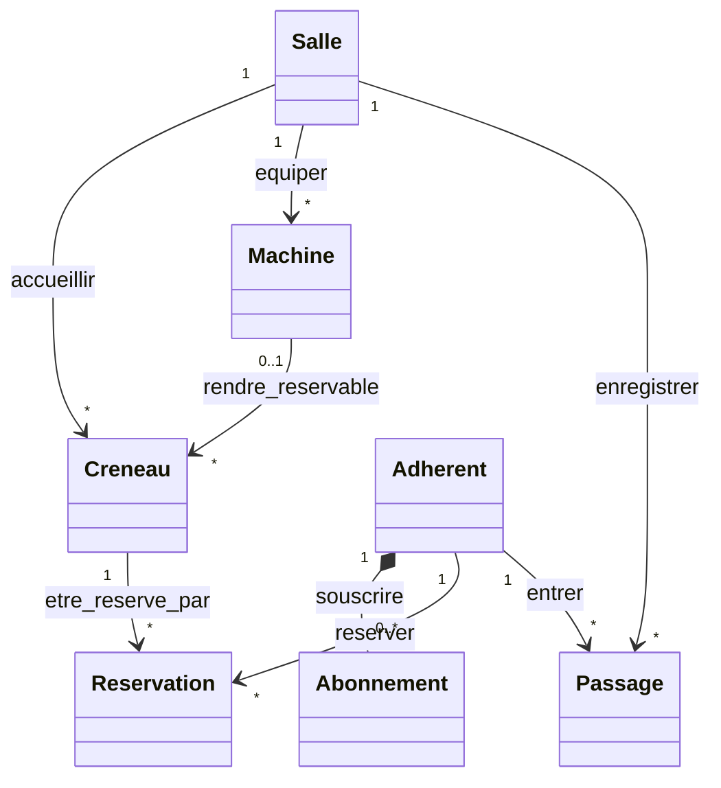

# TP S2 - Concevoir l’API de votre sujet

## 1. Modèle de ressources

### 1.1 Ressources choisies

| Ressource |
| :--- |
| `salles` |
| `machines` |
| `creneaux` |
| `reservations` |
| `abonnements` |
| `passages` |
| `adherents` |

Pour sélectionner les ressources j'ai décidé de repartir des ressoruces clés données dans le sujet et j'ai seulement ajouté la ressource "adherents" qui fait totalement sens dans ce contexte.

### 1.2 Diagramme

### 1.3 Sous-ressources

ToDO