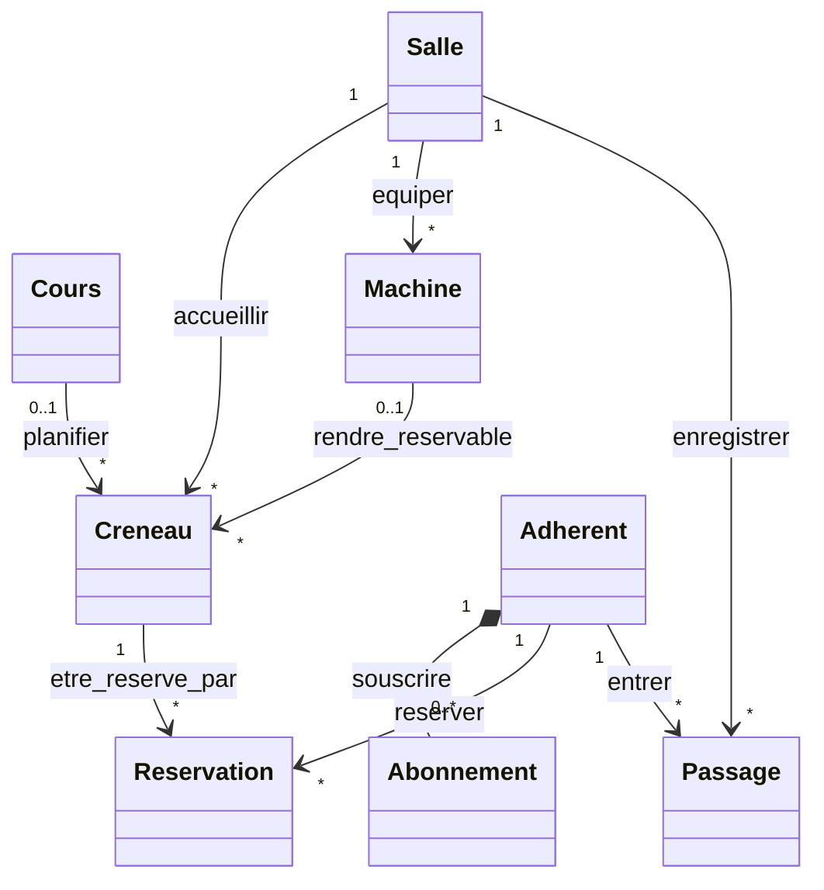

# TP S2 - Concevoir l’API de votre sujet

## 1. Modèle de ressources

### 1.1 Ressources choisies

| Ressource |
| :--- |
| `salles` |
| `cours` |
| `machines` |
| `creneaux` |
| `reservations` |
| `abonnements` |
| `passages` |
| `adherents` |

Pour sélectionner les ressources j'ai décidé de repartir des ressoruces clés données dans le sujet et j'ai seulement ajouté la ressource "adherents" et "cours" qui font totalement sens dans ce contexte.

### 1.2 Diagramme

### 1.3 Sous-ressources et filtres

Pour choisir entre sous-ressource et filtre nous avons appliqué une règle simple. Pour nous une relation est une sous-ressource si l'enfant fait réellement partie du parent, c'est-à-dire que si le parent est supprimé alors l'enfant disparaît. Sinon c'est un filtre. Dans le tableau, la colonne « Raison » précise ce choix, notamment pour les cas d'historique et de statistiques qu'on a décidé d'ajouter a certaines relations en fonction de notre logique.

| Relation | Décision | URI | Raison |
| :--- | :--- | :--- | :--- |
| Adhérent → Abonnement | Sous-ressource | `GET /adherents/{id}/abonnements` | Un abonnement ne peut pas exister sans adhérent, de plus l'abonnement ne peut pas changer de propriétaire, il est unique. Il ne peut être lu que par la ressource de l'adhérent. |
| Salle → Créneau | Sous-ressource | `GET /salles/{id}/creneaux?date=...` | Un créneau appartient à une seule salle, c'est le planning de la salle en question. Si la salle change alors c'est un nouveau créneau avec un nouvel id. |
| Salle → Passage | Sous-ressource | `GET /salles/{id}/passages?date=...` | Un passage est créé par la borne installée dans la salle, donc si la salle est supprimée nous n'avons plus d'accès à l'historique de cette salle. C'est normal : on ne garde pas de réservation ni d'historique pour une salle qui n'existe plus. |
| Salle → Machine | Filtre | `GET /machines?salle={id}` | Une machine appartient à une salle mais si la salle est supprimée la machine existe toujours en stock et peut être déplacée dans une nouvelle salle. |
| Adhérent → Réservation | Filtre | `GET /reservations?adherent={id}` | Une réservation n'existe que pour un adhérent et est unique mais reste en historique une fois la réservation passée, ce qui fait que si l'adhérent est supprimé cette réservation existera toujours car elle doit être conservée pour des stats et autres, c'est un choix qu'on a décidé de faire. |
| Créneau → Réservation | Filtre | `GET /reservations?creneau={id}` | Une réservation porte sur un seul créneau mais elle garde son propre id et son historique, donc dans la même optique que le filtre précédent, nous pensons aux stats. |
| Adhérent → Passage | Filtre | `GET /passages?adherent={id}` | Un passage est écrit par la borne quand l'adhérent passe son badge. Comme pour les filtres précédents on garde la notion de stats : ici c'est un journal, donc même si l'adhérent est supprimé, le passage existera toujours. |
| Machine → Créneau | Filtre | `GET /creneaux?machine={id}` | Un créneau n'a pas toujours de machine car dans les consignes du projet il y a la notion de cours collectifs, la machine est une information et on peut la changer sans que le créneau change d'id. |
| Cours → Créneau | Filtre | `GET /creneaux?cours={id}` | Un créneau peut être soit un cours, soit une machine. |

Au final, on se retrouve donc avec trois sous-ressources et six filtres.

## 2. Table des endpoints

| User story | Méthode | URI | Rôle autorisé | Corps de requête | Succès | Erreurs |
| :--- | :--- | :--- | :--- | :--- | :--- | :--- |
| Réserver un créneau | `POST` | `/reservations` | adhérent | `creneauId` | `201` + `Location` | `404`, `409`, `429` |
| Annuler | `POST` * | `/reservations/{reservationId}/annulation` | adhérent | — | `204` | `404`, `409` |
| Consulter l'affluence en temps réel | `GET` * | `/salles/{salleId}/affluence` | adhérent | — | `200` | `404` |
| Consulter son historique | `GET` * | `/adherents/{adherentId}/historique` | adhérent | — | `200` | `404` |
| Consulter le profil d'un utilisateur | `GET` * | `/adherents/{adherentId}` | adhérent, admin | — | `200` | `404` |
| Consulter les réservations d'une machine pour la journée | `GET` * | `/creneaux?machine={id}&date={date}` | adhérent, admin | — | `200` | `404` |
| Entrer avec son badge | `POST` | `/salles/{salleId}/passages` | borne | `badgeId`, `horodatage` | `201` + `Location` | `403`, `404`, `429` |
| Compteur machine | `PUT` * | `/machines/{machineId}/compteur` | borne | `valeur`, `horodatage` | `204` | `404`, `409`, `429` |
| Contrainte propre | `GET` * | `/adherents/{adherentId}/quota` | adhérent | — | `200` | `404` |

## 3. Revue Croisée 

ToDO