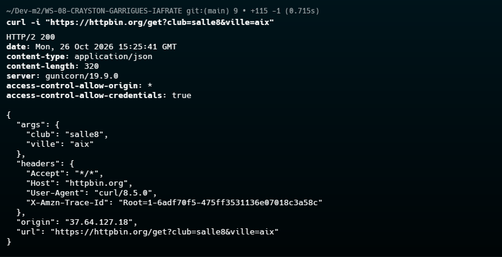
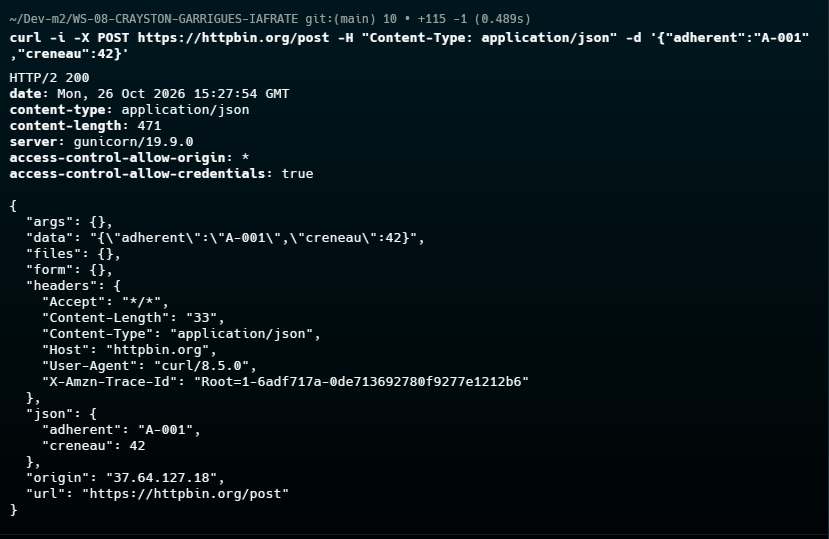
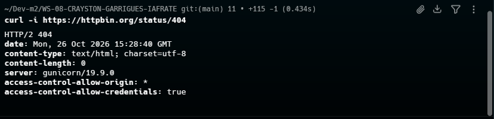
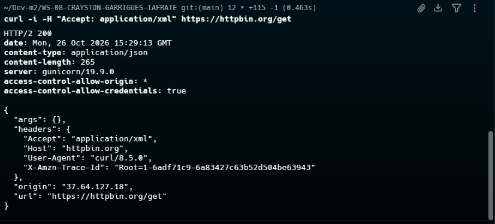

# Exploration HTTP — S01

## 1. GET avec paramètre de requête
`curl -i "https://httpbin.org/get?club=salle8&ville=aix"`

## 2. POST avec corps JSON
`curl -i -X POST https://httpbin.org/post -H "Content-Type: application/json" -d '{"adherent":"A-001","creneau":42}'`

## 3. Requête qui renvoie un 404
`curl -i https://httpbin.org/status/404`

## 4. Requête avec un `Accept` différent
`curl -i -H "Accept: application/xml" https://httpbin.org/get`

Note : httpbin ne négocie pas le contenu ; `Accept` n'a d'effet que si l'API l'implémente.
